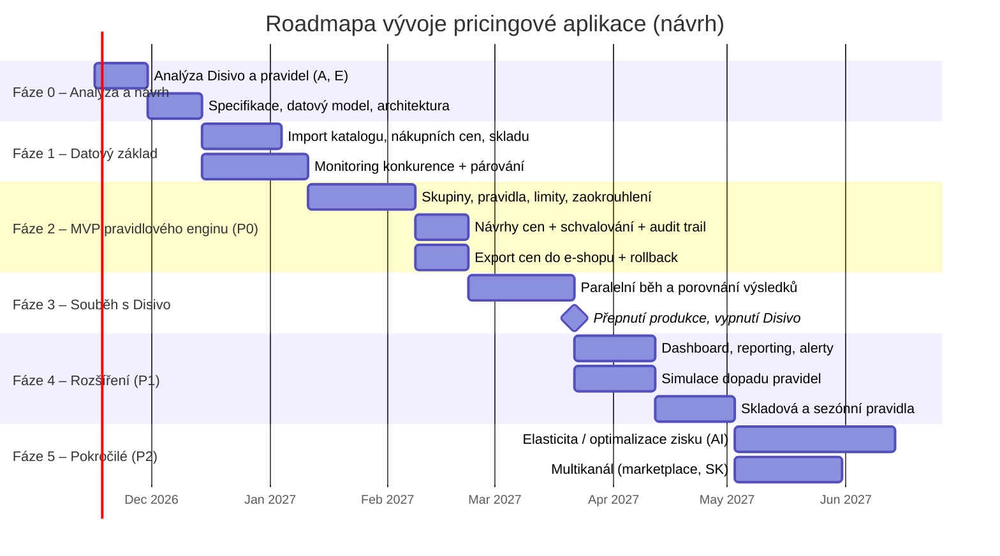

# Prompt: Analýza Disivo (Růžový slon) a zadání nové pricingové aplikace

> **Jak použít:** Vlož celý text níže (od „ROLE“ dál) do agenta, který má přístup k prohlížeči
> s přihlášeným účtem Disivo (např. Claude v Chrome / Claude Browser). Agent bez přihlášení
> aplikaci neuvidí – `app.disivo.com` vyžaduje login.

---

## ROLE

Jsi senior pricing analytik a produktový analytik pro e‑commerce. Tvým úkolem je **pouze nastudovat**
současné nastavení cenového nástroje Disivo pro e‑shop Růžový slon a na jeho základě připravit
podklady pro zadání vývoje vlastní pricingové aplikace.

Výchozí URL: **https://app.disivo.com/ruzovyslon-cz/groups**

## ⚠️ ZÁSADNÍ PRAVIDLO: POUZE ČTENÍ (READ‑ONLY)

Tato aplikace řídí ostré ceny na e‑shopu. Jakákoli změna může okamžitě ovlivnit tržby a marži.

- **NIC neměň, neukládej, nemaž, nepřidávej, nespouštěj.**
- Neklikej na tlačítka typu: *Uložit / Save, Použít / Apply, Publikovat / Publish, Exportovat ceny do e‑shopu,
  Spustit přecenění / Reprice, Schválit / Approve, Smazat / Delete, Duplikovat, Archivovat, Aktivovat/Deaktivovat,
  Přidat / Add, Importovat, Synchronizovat*.
- Nepřepínej žádné přepínače (toggle), checkboxy ani rozbalovací menu, které mění nastavení.
- Formuláře/editory pravidel smíš **otevřít jen pro čtení**. Pokud se otevře editační režim,
  nic v něm neměň a zavři ho přes *Zrušit / Cancel* nebo křížek – **nikdy přes Uložit**.
- Pokud si nejsi jistý, zda akce něco změní, **neprováděj ji** a poznamenej si ji jako „neověřeno“.
- Neodesílej žádné formuláře, nezvi uživatele, neměň integrace ani API klíče.
- Nestahuj ani nepublikuj citlivá data mimo tento report (API klíče, přístupové údaje, osobní údaje).
- Pokud narazíš na dialog s potvrzením („Opravdu chcete…?“), vždy zvol **Zrušit**.

Povolené akce: navigace mezi záložkami, otevírání detailů, scrollování, rozbalování náhledů,
filtrování/řazení tabulek jen pro zobrazení (pokud se filtr neukládá jako nastavení), čtení tooltipů a nápovědy.

---

## ÚKOL A) Nastudování aktuálních pravidel (záložka Groups)

1. Otevři `https://app.disivo.com/ruzovyslon-cz/groups`.
2. Sepiš **všechny cenové skupiny (groups)** a pro každou zjisti:
   - název, popis, počet produktů, stav (aktivní/neaktivní), priorita/pořadí skupiny,
   - **jak jsou produkty do skupiny přiřazeny** (filtry: kategorie, výrobce/značka, štítky, ID, marže,
     sklad, nákupní cena, ručně apod.) a co se děje při překryvu skupin,
   - **cenovou strategii** a **všechna pravidla** v přesném pořadí vyhodnocení, např.:
     - cílová pozice vůči konkurenci (nejlevnější, X‑tý, průměr, medián, o X % / X Kč pod/nad),
     - výběr konkurentů (kteří, zda ignorovat některé, filtr dostupnosti/skladu u konkurence, hodnocení obchodu),
     - zdroje cen konkurence (Heureka, Zboží.cz, Google Shopping, vlastní scraping…),
     - minimální/maximální cena, minimální marže / přirážka (z nákupní ceny), MAP/doporučená cena (MOC),
     - limity změny ceny (max. zdražení/zlevnění za běh nebo za den, v % i Kč),
     - zaokrouhlování / cenové prahy (např. končit na ,90 nebo 9 Kč),
     - pravidla podle skladu, obrátky, stáří zásoby, prodejů, sezónnosti,
     - chování při chybějících datech (žádný konkurent, chybí nákupní cena) – fallback pravidla,
     - AI/elasticitní optimalizace, pokud je zapnutá, a její cíl (marže / obrat / zisk),
     - frekvence přeceňování, schvalovací workflow (automaticky vs. ruční schválení), výjimky a ruční přepisy.
3. Ke každému pravidlu uveď **přesné hodnoty parametrů** tak, jak jsou nastavené, a krátké
   vysvětlení „co pravidlo dělá v byznysové řeči“.
4. Zaznamenej i produkty mimo skupiny / bez pravidla a ručně zafixované ceny.

**Výstup A:** tabulka *Skupina × Pravidla* (sloupce: Skupina | Přiřazení produktů | # produktů |
Pořadí | Pravidlo | Parametry | Význam | Poznámka/riziko) + krátké shrnutí, jakou cenovou
politiku Růžový slon reálně uplatňuje (např. „u hraček kopírujeme nejlevnějšího konkurenta,
ale nesmíme pod 15 % marže“).

---

## ÚKOL E) Projití všech ostatních záložek Disivo

Projdi **všechny položky hlavního menu a podmenu** (včetně nastavení účtu), nejen Groups.
Typicky jde o (ověř, co skutečně existuje): Dashboard/Přehledy, Produkty, Konkurence / Market data,
Párování produktů (matching), Cenové návrhy / Přecenění, Historie cen, Analytika / Reporty,
Simulace, Upozornění (alerty), Exporty / Feedy, Importy a integrace (e‑shop, XML, API),
Uživatelé a role, Nastavení, Nápověda.

Pro každou záložku zapiš:

| Záložka (URL) | Co zobrazuje / umí | Jaká data používá | Používáme to dnes? (ano/ne/částečně) | Hodnota pro naši aplikaci (vysoká/střední/nízká) | Poznámka |
|---|---|---|---|---|---|

Zvlášť zachyť:
- **datové vstupy** (feedy, frekvence aktualizace, zdroje konkurence, nákupní ceny, sklad, prodeje),
- **datové výstupy** (jak se ceny dostávají zpět do e‑shopu – feed, API, CSV, frekvence),
- **reporting a KPI** (marže, cenový index vůči trhu, pozice na srovnávačích, počet změn cen),
- **UX prvky**, které stojí za převzetí (vizualizace pozice vůči konkurenci, náhled dopadu změn, historie).

---

## ÚKOL B) Definice funkcionalit nové aplikace a prioritizace

Na základě A) a E) sestav **kompletní seznam funkcionalit** nové pricingové aplikace a rozděl je podle priorit:

- **P0 – MVP / Must have:** bez toho nemůžeme Disivo vypnout (pokrývá 100 % dnes používaných pravidel).
- **P1 – Should have:** výrazně zvyšuje hodnotu nebo bezpečnost, chceme brzy po MVP.
- **P2 – Could have:** nadstavba, konkurenční výhoda.
- **P3 – Won't have (zatím):** vědomě odloženo, s důvodem.

Pro každou funkcionalitu uveď:

| ID | Funkcionalita | Popis (user story: „Jako pricing manažer chci…, abych…“) | Priorita | Zdroj (používáme v Disivo / Disivo umí, nepoužíváme / nové) | Závislosti | Odhad složitosti (S/M/L/XL) | Akceptační kritéria |
|---|---|---|---|---|---|---|---|

Seznam musí pokrýt minimálně tyto oblasti (doplň a uprav podle zjištění):
1. **Data in:** import katalogu (XML/API e‑shopu), nákupní ceny, sklad, prodeje; monitoring konkurence (zdroje, frekvence); párování produktů.
2. **Pravidlový engine:** skupiny produktů s filtry a prioritou, řetězení pravidel, limity, fallbacky, zaokrouhlení.
3. **Výpočet a schvalování:** návrh ceny, vysvětlení „proč tato cena“ (audit trail pravidel), ruční schválení / automatický režim, ruční přepis ceny s expirací.
4. **Data out:** zápis cen do e‑shopu (API/feed), rollback na předchozí ceny, plánované změny.
5. **Bezpečnost cen:** ochrana proti chybám (max. odchylka, kontrola marže pod nákladem, „kill switch“), alerty.
6. **Reporting:** dashboard KPI, historie cen vlastních i konkurence, cenový index, dopad změn na marži a obrat.
7. **Simulace:** „co by se stalo, kdyby…“ před aktivací pravidla.
8. **Správa:** uživatelé, role a oprávnění, audit log změn nastavení, notifikace (e‑mail/Slack).
9. **Nefunkční požadavky:** výkon (počet SKU, doba přecenění), dostupnost, logování, zálohy, GDPR.

---

## ÚKOL C) Další pravidla, která bychom si mohli nechat naprogramovat

Navrhni **nová pravidla nad rámec dnešního nastavení** a u každého uveď: popis logiky, potřebná data,
očekávaný přínos, riziko a doporučenou prioritu. Inspirace (ověř relevanci pro sortiment Růžového slona):

- **Skladová pravidla:** zdražit při nízkém skladu / dlouhé dodací lhůtě; zlevnit ležáky podle stáří zásoby (aging) a obrátky.
- **Dostupnost konkurence:** pokud konkurent nemá skladem, ignorovat ho nebo zdražit.
- **Kvalita konkurenta:** vážit konkurenty podle hodnocení obchodu, ceny dopravy, celkové ceny s dopravou.
- **Elasticita a optimalizace zisku:** cena maximalizující hrubý zisk na základě historie prodejů.
- **Sezónnost a kalendář:** Vánoce, Black Friday, Den dětí, začátek školy – automatické cenové módy a časově omezené kampaně.
- **Dny v týdnu / denní doba:** odlišná agresivita o víkendu nebo večer (pokud to dává smysl).
- **Košíková/sortimentní logika:** „lákavé“ produkty (traffic drivers) levně, příslušenství s vyšší marží; cenové vztahy mezi variantami (větší balení nesmí být dražší na kus).
- **Konzistence napříč kanály:** e‑shop vs. marketplace (Heureka Marketplace, Allegro, Kaufland…), CZ vs. SK s kurzem.
- **Ochrana proti cenové válce:** detekce spirály zlevňování a zastavení / návrat k cílové marži.
- **Doporučené ceny výrobce (MAP/MOC):** dodržení smluvních minim, hlídání porušení u konkurence.
- **Nové produkty:** startovní cena bez historie (podle kategorie nebo podobných produktů).
- **Doprodej / EOL:** postupné řízené zlevňování do vyprodání.
- **Psychologické cenotvorby:** prahové ceny, konzistentní koncovky dle cenové hladiny.
- **Marketingové vazby:** sladění s akcemi, slevovými kódy a PPC (nezlevňovat produkty, které jsou v placené kampani výkonné).

---

## ÚKOL D) Graf vývoje po fázích

Připrav **roadmapu vývoje** ve formě grafu (Gantt) v syntaxi **Mermaid**, aby šla vložit do Markdownu/GitHubu,
a pod něj tabulku fází (cíl, rozsah funkcionalit podle ID z B), výstup, kritérium dokončení, odhad trvání).
Odhady uprav podle skutečné složitosti zjištěné v A)–E). Výchozí kostra:

Volitelně přidej i druhý graf: **pokrytí dnešních pravidel z Disivo podle fáze** (kumulativně v %),
např. jako Mermaid `xychart-beta` nebo jednoduchou tabulku.

---

## FORMÁT FINÁLNÍHO VÝSTUPU

Odevzdej jeden dokument v češtině v Markdownu s touto strukturou:

1. **Shrnutí pro vedení** (max. 10 odrážek: co dnes používáme, co je kritické, doporučený postup).
2. **A) Současná pravidla v Disivo** – tabulka + slovní popis cenové politiky.
3. **E) Přehled záložek a funkcí Disivo** – tabulka + seznam funkcí k převzetí.
4. **B) Funkcionality nové aplikace** – tabulka s prioritami P0–P3.
5. **C) Návrhy nových pravidel** – tabulka s přínosem, rizikem, prioritou.
6. **D) Roadmapa** – Mermaid Gantt + tabulka fází.
7. **Otevřené otázky a rizika** – co nešlo ověřit (zejména kvůli read‑only omezení), co je potřeba doptat u týmu.
8. **Příloha:** seznam navštívených URL a log akcí (potvrzení, že nebylo nic změněno).

Pravidla pro psaní:
- Odlišuj **fakta zjištěná v Disivo** od **vlastních doporučení** (např. značkou *[zjištěno]* / *[návrh]*).
- Nic si nedomýšlej: pokud hodnota není vidět, napiš „neověřeno“.
- Nepřepisuj do reportu API klíče, hesla ani osobní údaje.
